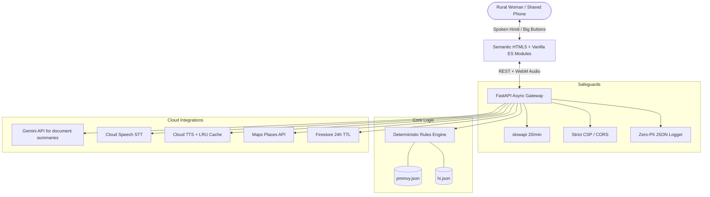

# Sakhi – आपकी आवाज़ दीदी (Sakhi – Your Voice Didi)

[](https://github.com/samudragupto/sakhi/actions/workflows/ci.yml)
[](pyproject.toml)
[](LICENSE)
[](pyproject.toml)

> **Voice-first, zero-literacy AI civic-tech assistant that empowers rural women to independently access essential government maternal health benefits (PMMVY 2.0) on shared mobile phones.**

---

## 1. Problem Statement Alignment

> *"Build an AI tool that helps a first-time woman user — with no English, no tech background, and no one to ask — independently access one essential government service, scheme, or skill resource through voice or simple text in her own language. The tool must require zero prior digital knowledge to use."*

### Who is She? (Target Persona)
- **Name:** Sunita, 22 years old, expecting her first child in a rural village.
- **Language:** Hindi speaker (Devanagari script), **no English**.
- **Tech Literacy:** **Zero prior digital knowledge**, cannot read complex forms, **no tech background**.
- **Device:** Accesses the internet solely via a **shared family phone**.
- **Social Context:** **No one to ask** without feeling hesitant or judged; needs to **independently** check if she can receive financial aid for nutrition and vaccination.

### Sustainable Development Goals (SDG) Alignment
- **SDG 5: Gender Equality (Target 5.1 & 5.b):** Direct financial assistance into woman-owned bank accounts under PMMVY 2.0; leveraging voice AI technology to eliminate systemic gender barriers.
- **SDG 4: Quality Education & Lifelong Learning (Target 4.3 & 4.4):** Voice-guided public service education, empowering citizens with civic knowledge regardless of formal literacy.
- **SDG 10: Reduced Inequalities (Target 10.2):** Empowering rural, low-income, and marginalized communities (SC/ST, MGNREGA, BPL ration card holders, informal e-Shram laborers) to access legal welfare rights.

---

## 2. Key Features

| Feature | Description |
| :--- | :--- |
| **🎙️ Voice-First Interaction** | Giant 130px microphone; Cloud Speech-to-Text (`hi-IN`) with large Hindi choice buttons when speech is unavailable. |
| **🔊 Spoken Neural Prompts** | Cloud Text-to-Speech Neural2 voices (`hi-IN-Neural2-A`) at a natural 0.9x speed, with in-memory LRU audio caching and browser speech fallback. |
| **⚖️ Deterministic Rules Engine** | 100% deterministic Python rules engine for PMMVY 2.0; LLMs **never** calculate eligibility or benefit amounts. |
| **🔒 Shared Phone Privacy Mode** | Instant panic screen swap ("छुपाएँ" / `Escape` / triple-tap) to a convincing cooking recipe; single-tap data wipe ("सब मिटाएँ"). |
| **📜 Bilingual Officer Card** | Generates a high-contrast Hindi/English summary card with official QR code linking to the government portal. |
| **📍 Anganwadi Centre Locator** | Google Maps Places API (New) integration with privacy coordinate rounding to find nearest rural centres. |
| **📄 Paper Whisperer API** | Optional Hindi document-image summary through Gemini; images are processed in memory and sent to Google only when the Gemini API is configured. |
| **🎭 Practice Mode API** | Scripted role-play endpoint for rehearsing an Anganwadi visit. |

---

## 3. Google Cloud Services Mapping

| Google Service | Purpose in Sakhi | Exact Module File Path | Safe Local Fallback |
| :--- | :--- | :--- | :--- |
| **Gemini API (2.5 Flash)** | Optional document-image summaries only; eligibility remains deterministic | [`app/services/gemini_service.py`](app/services/gemini_service.py) | Generic Hindi guidance when unavailable |
| **Cloud Speech-to-Text** | Voice transcription in Hindi (`hi-IN`) | [`app/services/speech_service.py`](app/services/speech_service.py) | Hindi prompt plus visible choice buttons |
| **Cloud Text-to-Speech** | High-fidelity neural voice synthesis (`hi-IN-Neural2-A`) | [`app/services/tts_service.py`](app/services/tts_service.py) | In-memory LRU audio cache -> browser Web Speech synthesis |
| **Maps Places API (New)** | Nearby Anganwadi & Common Service Centres | [`app/services/maps_service.py`](app/services/maps_service.py) | Generic rural centre guidance |
| **Cloud Firestore** | Anonymous session tracking with 24-hour TTL | [`app/services/session_service.py`](app/services/session_service.py) | In-memory auto-expiring dictionary store |
| **Secret Manager** | Secure production credential loading | [`app/core/config.py`](app/core/config.py) | Local `.env` and environment variables |

---

## 4. Architecture Diagram



---

## 5. Local Setup & Quick Start

### Prerequisites
- Python 3.12+
- `uv` (recommended) or `pip`

### 1. Clone & Install Dependencies
```bash
git clone https://github.com/samudragupto/sakhi.git
cd sakhi
uv venv .venv
source .venv/bin/activate  # On Windows: .venv\Scripts\activate
uv pip install -e .[dev]
```

### 2. Configure Environment
```bash
cp .env.example .env
```
*(The app runs completely offline with zero credentials out-of-the-box using built-in fallbacks).*

### 3. Run Locally
```bash
uvicorn app.main:app --host 0.0.0.0 --port 8080 --reload
```
Open [http://localhost:8080/static/index.html](http://localhost:8080/static/index.html) in your browser.

---

## 6. Testing & Quality Verification

```bash
# Lint checks
ruff check .
ruff format --check .

# Static type verification
mypy app

# Automated tests with coverage (>= 90% target)
pytest --cov=app --cov-branch --cov-report=term-missing
```

---

## 7. Container & Firestore Setup

### 1. Build and Run via Docker
```bash
docker build -t sakhi-app:latest .
docker run -p 8080:8080 sakhi-app:latest
```

### 2. Enable 24-Hour Session TTL in Cloud Firestore
```bash
gcloud firestore fields ttls update expire_at \
    --collection-group=sessions \
    --enable-ttl \
    --project="$GCP_PROJECT_ID"
```

---

## 8. Extensibility: Adding Schemes
- **Add a Scheme:** Add a scheme definition to `app/data/schemes/{scheme_id}.json`.
- **Hindi UI strings:** Edit `app/data/locales/hi.json`.

---

## 9. License
Licensed under the [MIT License](LICENSE).
