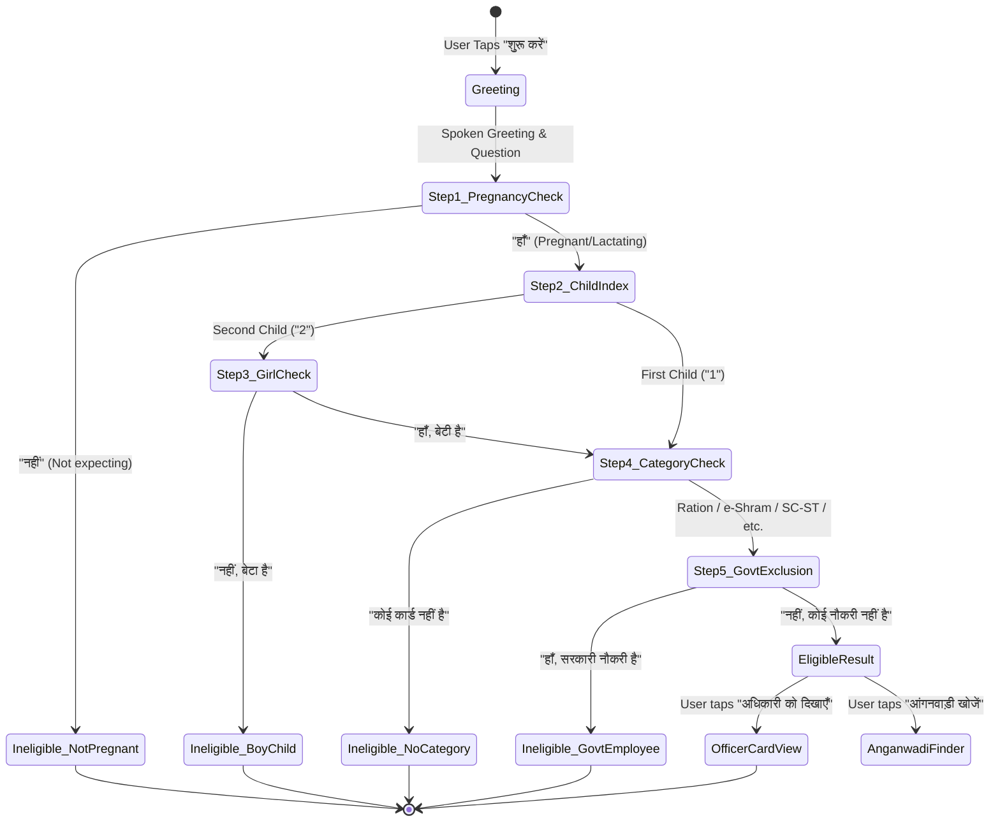
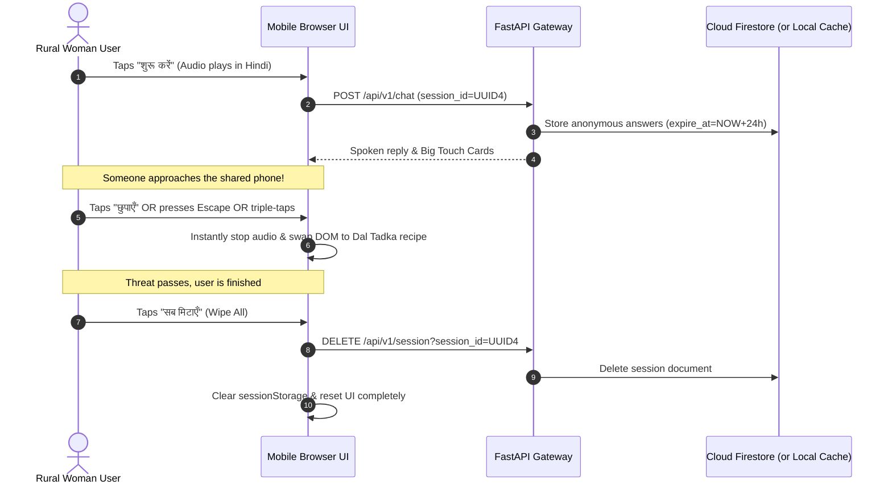

# System Architecture: Sakhi – आपकी आवाज़ दीदी

## 1. High-Level System Architecture

```mermaid
graph TD
    subgraph ClientLayer["Zero-Literacy Frontend (< 50 KB Vanilla JS)"]
        User(["Rural Woman User / Shared Mobile"]) <-->|Devanagari Voice / Audio Playback| AudioEngine["Audio Pipeline (WebM Mic Capture & TTS Playback)"]
        User <-->|Big Touch Cards / Yes-No Buttons| DOM["Accessible Semantic DOM (WCAG 2.2 AA)"]
        DOM -->|Escape / Triple-Tap| PanicScreen["Neutral Panic Recipe Screen (छुपाएँ)"]
    end

    subgraph Gateway["FastAPI Async Gateway (Port 8080)"]
        AudioEngine -->|POST /api/v1/voice/transcribe| VoiceRouter["Voice Router (/voice)"]
        AudioEngine <--|POST /api/v1/voice/speak| VoiceRouter
        DOM -->|POST /api/v1/chat| ChatRouter["Chat Router (/chat)"]
        DOM -->|POST /api/v1/vision/explain| VisionRouter["Document Summary Router (/vision)"]
        DOM -->|GET /api/v1/places/nearby| PlacesRouter["Places Router (/places)"]
        DOM -->|POST /api/v1/card| CardRouter["Card Router (/card)"]
        DOM -->|DELETE /api/v1/session| SessionRouter["Session Router (/session)"]
        
        SecMiddleware["Security Headers (Strict CSP, Nosniff, HSTS)"] --> Gateway
        RateLimiter["slowapi Rate Limiter (20/min voice & chat)"] --> Gateway
        LogFilter["Structured JSON stdout logger"] --> Gateway
    end

    subgraph CoreEngines["Deterministic Core Engines & Data"]
        ChatRouter --> EligibilityEngine["PMMVY 2.0 Rules Engine (Pure Python)"]
        EligibilityEngine --- SchemeJSON[("pmmvy.json (Single Source of Truth)")]
        EligibilityEngine --- LocaleJSON[("hi.json")]
    end

    subgraph GoogleServices["Google Cloud Platform Services & Fallbacks"]
        VisionRouter -->|google-genai| GeminiModel["Gemini 2.5 Flash image summary"]
        GeminiModel -. Fallback .-> VisionRouter
        
        VoiceRouter <-->|gRPC / REST| CloudSTT["Cloud Speech-to-Text (hi-IN)"]
        VoiceRouter <-->|gRPC / REST| CloudTTS["Cloud Text-to-Speech (hi-IN-Neural2-A)"]
        CloudTTS --- LRUCache[("In-Memory LRU Audio Cache")]
        
        PlacesRouter <-->|httpx async| PlacesAPI["Maps Places API (New)"]
        SessionRouter <-->|Firestore Client| FirestoreTTL[("Cloud Firestore (24h TTL)")]
    end
```

## 2. Conversational State Machine



## 3. Privacy & Shared Phone Lifecycle


